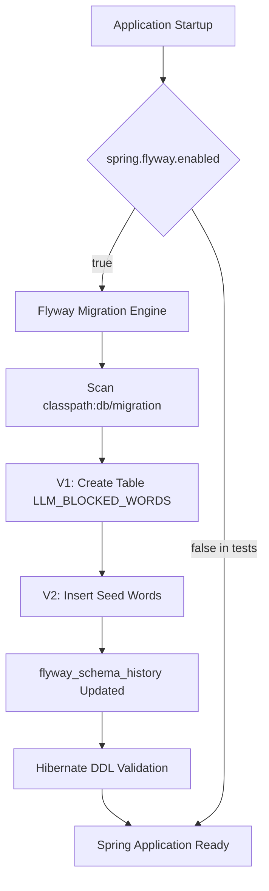

# Requirements

### Overview & Goals
When `spring.flyway.enabled=true` is enabled in `AiModel/src/main/resources/application.properties`, Spring Boot automatically runs Flyway database migrations upon application startup. However, several critical configuration and migration script conflicts exist in the current project that will cause application startup failures, migration errors, or test execution breaks.

### Identified Problems with `spring.flyway.enabled=true`

1. **Duplicate Migration Version Collision (Fatal Startup Error)**:
   - There are two migration files located in `src/main/resources/db/migration/`:
     - `V1__Blocked_Words_In_LLM.sql` (table creation DDL)
     - `V2__Seed_Blocked_Words_In_LLM.sql` (data insertion DML)
   - Flyway strictly forbids duplicate version numbers (`V1__`). On application boot with `spring.flyway.enabled=true`, Flyway throws a `FlywayException: Found more than one migration with version 1`, halting the Spring application startup immediately.

2. **Missing Baseline Configuration for Non-Empty Existing Databases**:
   - `spring.flyway.baseline-on-migrate` is not configured (defaults to `false`).
   - If the `cester` database already exists and has tables created previously (e.g. from previous manual runs or JPA tools), Flyway will fail with `FlywayException: Found non-empty schema(s) without metadata table! Use baseline.`.

3. **Hardcoded Datasource & Database Initialization Constraints**:
   - `spring.datasource.url=jdbc:mysql://localhost:3306/cester` is hardcoded with static credentials.
   - Flyway operates inside an existing database schema; if the database `cester` has not been pre-created on the MySQL server, connection will fail on boot.
   - Hardcoded values prevent containerized or CI/CD deployments from injecting database credentials.

4. **Integration Test Breakage (`@SpringBootTest`)**:
   - `AiModelApplicationTests` runs with `@SpringBootTest`, which loads `application.properties` by default.
   - When `spring.flyway.enabled=true`, running Maven builds (`mvn test` or `mvn compile`) will fail if a local MySQL instance on port 3306 is unavailable.

5. **Interaction with `spring.jpa.hibernate.ddl-auto=validate`**:
   - While `ddl-auto=validate` combined with Flyway is standard practice (Flyway migrates first, Hibernate validates), any failure in Flyway or mismatch between entity definitions (like `LLM_BLOCKED_WORDS`) and the Flyway schema will fail Hibernate validation.

### Scope
- **In Scope**:
  - Renaming and sequencing migration files under `AiModel/src/main/resources/db/migration/`.
  - Adding Flyway baseline configuration (`spring.flyway.baseline-on-migrate=true`).
  - Parameterizing datasource properties with fallback defaults.
  - Adding test-specific configuration to disable or mock Flyway in test environments.
- **Out of Scope**:
  - Changing business logic in `ChatController` or `ChatService`.
  - Modifying external microservice databases.

# Technical Design

### Current Implementation
In `AiModel/src/main/resources/application.properties`:
```properties
spring.application.name=AiModel
server.port=8170
spring.ai.google.genai.api-key=${GEMINI_API_KEY}
spring.ai.google.genai.chat.model=gemini-3.5-flash-lite
spring.ai.openai.api-key=${GROQ_CLOUD_API}
spring.ai.openai.base-url=https://api.groq.com/openai/v1
spring.datasource.url=jdbc:mysql://localhost:3306/cester
spring.datasource.username=root
spring.datasource.password=jishu123
spring.jpa.hibernate.ddl-auto=validate
spring.flyway.enabled=true
```

In `AiModel/src/main/resources/db/migration/`:
- `V1__Blocked_Words_In_LLM.sql`
- `V2__Seed_Blocked_Words_In_LLM.sql`

In `AiModel/pom.xml`:
- Flyway dependencies `flyway-core` (version 13.7.0) and `flyway-mysql` are present.

### Key Decisions
1. **Migration Version Numbering**: Use sequential semantic versioning:
   - `V1__Blocked_Words_In_LLM.sql`: Schema definition for table `LLM_BLOCKED_WORDS`.
   - `V2__Seed_Blocked_Words_In_LLM.sql`: Initial seed data for blocked words.
2. **Flyway Baseline Strategy**: Enable `spring.flyway.baseline-on-migrate=true` and `spring.flyway.baseline-version=0` to ensure safe operation against existing databases without corrupting schema history.
3. **Test Isolation**: Disable Flyway execution during unit/integration tests (`spring.flyway.enabled=false`) unless an in-memory database or Testcontainers is explicitly configured for migration testing.

### Proposed Changes

#### 1. Migration File Structure
Rename `../../AiModel/src/main/resources/db/migration/V2__Seed_Blocked_Words_In_LLM.sql` to:
`AiModel/src/main/resources/db/migration/V2__Seed_Blocked_Words_In_LLM.sql`

#### 2. Configuration Properties in `application.properties`
Update `application.properties` to include baseline settings and parameterized database environment variables:
```properties
spring.datasource.url=${SPRING_DATASOURCE_URL:jdbc:mysql://localhost:3306/cester}
spring.datasource.username=${SPRING_DATASOURCE_USERNAME:root}
spring.datasource.password=${SPRING_DATASOURCE_PASSWORD:jishu123}
spring.jpa.hibernate.ddl-auto=validate

# Flyway Configuration
spring.flyway.enabled=true
spring.flyway.baseline-on-migrate=true
spring.flyway.baseline-version=0
spring.flyway.locations=classpath:db/migration
```

#### 3. Test Configuration
Create `AiModel/src/test/resources/application-test.properties` (or `application.properties` in test resources):
```properties
spring.flyway.enabled=false
spring.jpa.hibernate.ddl-auto=none
```

### Architecture Diagram


### Risks & Mitigations
- **Risk**: Existing database instance already has `LLM_BLOCKED_WORDS` table created without `flyway_schema_history`.
  - **Mitigation**: Setting `spring.flyway.baseline-on-migrate=true` prevents Flyway from failing on existing schemas.
- **Risk**: Test execution fails on machines without MySQL installed.
  - **Mitigation**: Disabling Flyway in the test profile isolates unit testing from database availability.

# Testing

### Validation Approach
Verify that Spring Boot startup, Flyway migration execution, and test execution succeed without errors.

### Key Scenarios
1. **Application Startup with Clean Database**:
   - Flyway executes `V1__Blocked_Words_In_LLM.sql` followed by `V2__Seed_Blocked_Words_In_LLM.sql`.
   - Table `LLM_BLOCKED_WORDS` and table `flyway_schema_history` are created with 2 applied migration records.
2. **Application Startup with Existing Database (Baseline on Migrate)**:
   - When `flyway_schema_history` is absent but tables exist, Flyway baselines to version 0 and applies subsequent migrations without throwing an exception.
3. **Spring Boot Integration Test Run**:
   - `AiModelApplicationTests` runs without attempting to connect to MySQL or execute Flyway migrations when Flyway is disabled in test profile.

### Edge Cases
- Duplicate version numbers (`V1__...` vs `V1__...`) -> Resolved by renaming to `V2__...`.
- Column case sensitivity in MySQL vs SQL queries (`Word`, `Is_deleted`).
- Database schema does not exist -> Mitigated by ensuring datasource URL specifies an existing schema or creating it beforehand.

# Delivery Steps

###   Step 1: Resolve duplicate Flyway migration version conflict
All Flyway migration script version conflicts in `AiModel/src/main/resources/db/migration/` are eliminated and versioned sequentially.

- Rename `V2__Seed_Blocked_Words_In_LLM.sql` to `V2__Seed_Blocked_Words_In_LLM.sql` to resolve the duplicate `V1__` version conflict.
- Ensure `V1__Blocked_Words_In_LLM.sql` contains the DDL schema creation and `V2__Seed_Blocked_Words_In_LLM.sql` contains the initial seed data.
- Verify SQL syntax compatibility with MySQL (quoting, column names, timestamp functions).

###   Step 2: Configure Flyway baseline and resilient database properties
Flyway is configured with baseline fallback and resilient database settings in `application.properties`.

- Add `spring.flyway.baseline-on-migrate=true` to allow Flyway to initialize successfully if the target database already contains existing tables without a schema history table.
- Set `spring.flyway.baseline-version=0` (or `1`) to establish the baseline starting point.
- Ensure datasource credentials and connection settings support environment variable overrides (e.g., `${DB_URL:...}`, `${DB_USERNAME:...}`, `${DB_PASSWORD:...}`).

###   Step 3: Isolate Flyway migration execution in test profile
The test suite runs reliably without requiring an active MySQL instance or failing on Flyway migrations.

- Add a test configuration or `@TestPropertySource` / `application-test.properties` under `AiModel/src/test/resources/` with `spring.flyway.enabled=false` or an in-memory database configuration.
- Verify that `AiModelApplicationTests` context loads cleanly in test environments.